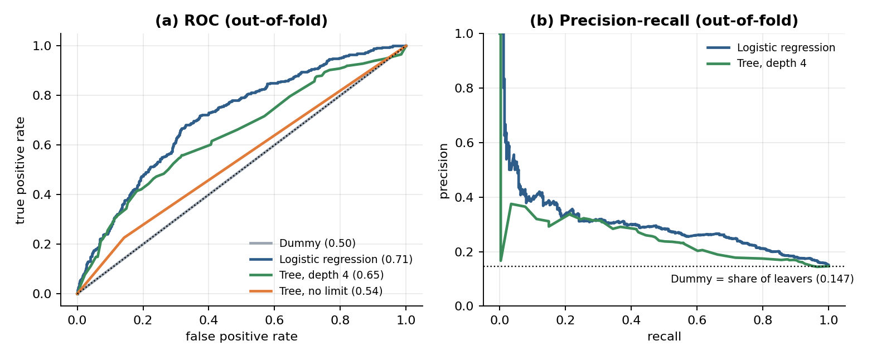
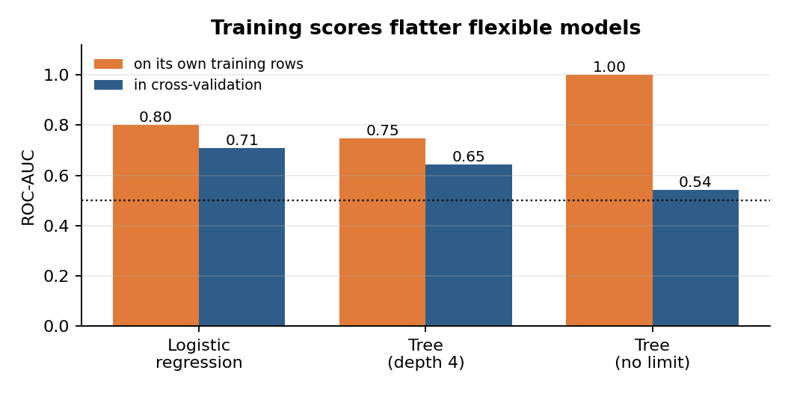

# Day 3 — Task 3: First honest baselines (evidence report)

Notebook: [`notebooks/02_baselines.ipynb`](../notebooks/02_baselines.ipynb) (executed). Code: [`src/cortexhr/baselines.py`](../src/cortexhr/baselines.py), [`scripts/run_notebook.py`](../scripts/run_notebook.py). Tests: [`tests/test_baselines.py`](../tests/test_baselines.py). Saved numbers: [`reports/tables/day3_findings.json`](tables/day3_findings.json), [`day3_baseline_comparison.csv`](tables/day3_baseline_comparison.csv), [`day3_controls.csv`](tables/day3_controls.csv).

**Status:** done and tested in the environment used (pandas 2.3.3, scikit-learn 1.8.0, Python 3.12). Docker was not run. The repository on GitHub could not be opened from this environment, so nothing was pushed.

## 1. Set-up

* **X and y:** `X` = 33 allowed input columns from Day 2 (`select_features`), 2,379 rows; `y` = `left_within_12m`, 349 leavers (14.67%). The target is not in `X`.
* **Rows:** 2,379, not 2,389: Task 1 removed 6 duplicates, and 4 negative-tenure rows are left out until open item O1 is answered.
* **Folds:** `StratifiedKFold(n_splits=5, shuffle=True, random_state=42)`, built once as a list and passed to every model. Each test fold has 475 to 476 rows and 69 to 70 leavers (14.5% to 14.7%).
* **Preprocessing inside the folds:** the Day 2 pipeline is the first step of every model, so it is re-fitted on the training part of each fold. A unit test shows that the out-of-fold predictions equal a manual loop that fits the scaler on each training fold only.
* **Scores:** out-of-fold probabilities from `cross_val_predict`; per-fold scores are then computed on the same folds so they can be compared with the benchmark sheet (which reports a mean over 5 folds).

| fold | test_rows | test_leavers | leaver_share_% |
|---|---|---|---|
| 1.0 | 476.0 | 70.0 | 14.71 |
| 2.0 | 476.0 | 70.0 | 14.71 |
| 3.0 | 476.0 | 70.0 | 14.71 |
| 4.0 | 476.0 | 70.0 | 14.71 |
| 5.0 | 475.0 | 69.0 | 14.53 |

## 2. Comparison table (ours vs `baseline_benchmarks`)

Our numbers are per-fold means over the same 5 stratified folds (ROC-AUC shown as mean ± sd). Precision, recall and accuracy are at the 0.5 threshold.

| model | ROC-AUC (ours) | ROC-AUC (benchmark) | diff | PR-AUC ours | PR-AUC bench | precision ours | precision bench | recall ours | recall bench | accuracy ours | accuracy bench |
|---|---|---|---|---|---|---|---|---|---|---|---|
| Dummy (always stays) | 0.500 +/- 0.000 | 0.500 +/- 0.000 | +0.000 | 0.147 | 0.146 | 0.000 | 0.000 | 0.000 | 0.000 | 0.853 | 0.854 |
| Logistic Regression (balanced) | 0.712 +/- 0.018 | 0.713 +/- 0.010 | -0.001 | 0.309 | 0.332 | 0.265 | 0.260 | 0.633 | 0.630 | 0.686 | 0.683 |
| Decision Tree (depth 4, balanced) | 0.654 +/- 0.038 | 0.650 +/- 0.019 | +0.004 | 0.255 | 0.256 | 0.236 | 0.234 | 0.525 | 0.524 | 0.681 | 0.676 |
| Decision Tree (no depth limit, balanced) | 0.542 +/- 0.028 | not in sheet |  | 0.164 |  | 0.214 |  | 0.226 |  | 0.765 |  |

Not reproduced (reference only): Random Forest, 300 trees (benchmark ROC-AUC 0.715) and the LEAKY logistic regression (1.000).

Logistic regression, pooled out-of-fold: ROC-AUC 0.710, PR-AUC 0.298.



*In (b) the Dummy and the unlimited tree are left out: they have only one or a few distinct scores, so their drawn "curve" would be a misleading straight line. The Dummy's PR-AUC is the dotted line (the share of leavers).*

## 3. The Dummy result

Accuracy is 0.853 only because 85.3% of people stay. It catches nobody (recall 0, precision 0), its ROC-AUC is exactly 0.5 because every row gets the same score, and its PR-AUC (0.147) equals the share of leavers. So 0.5 ROC-AUC and 0.147 PR-AUC are the scores we get for free.

## 4. Scores vs yes/no predictions (logistic regression, threshold 0.5)

The same probabilities give very different pictures depending on how they are used. Ranking (ROC-AUC 0.71): a random leaver gets a higher score than a random stayer about 71% of the time. Yes/no at 0.5: 35.3% of people are flagged; 221 of 349 leavers are caught (recall 0.63), 618 stayers are flagged wrongly, and only 26.3% of the flags are right. Choosing the cut-off and the metrics is Task 4.

## 5. Decision tree: why training scores lie

| model | AUC on its own training rows | AUC in cross-validation | gap |
|---|---|---|---|
| Logistic Regression (balanced) | 0.801 | 0.71 | 0.091 |
| Decision Tree (depth 4, balanced) | 0.747 | 0.645 | 0.102 |
| Decision Tree (no depth limit, balanced) | 1.0 | 0.542 | 0.458 |



An unrestricted tree can keep splitting until every training row is alone in a leaf. It fits the training rows perfectly, noise included, but the rules it learned for one group of employees mostly do not repeat in another group, so on held-out folds it is barely better than chance. Limiting depth to 4, or using logistic regression, shrinks the gap. In this notebook every reported score is out-of-fold; the "own training rows" column is shown only to illustrate the problem.

## 6. Is the gap believable?

* **Fold-to-fold noise:** logistic-regression ROC-AUC sd 0.018 (benchmark sd 0.010).
* **Split-to-split noise:** over 10 different fold splits the pooled ROC-AUC averages 0.711 (sd 0.005, range 0.703 to 0.716).
* **Bootstrap:** 95% interval for the pooled ROC-AUC 0.679 to 0.737; the benchmark's 0.713 is inside it.
* **Shuffled labels (control):** ROC-AUC 0.487, which is chance. If the pipeline leaked labels, this would sit above 0.5.
* **Preprocessing outside the folds (control):** 0.7103 vs 0.7103 done properly: no measurable difference here.
* **Feature sets** (same folds, logistic regression):

| logistic regression, feature set | input columns | ROC-AUC (pooled) |
|---|---|---|
| main feature set | 33 | 0.7103 |
| without the monthly attendance/payroll features | 30 | 0.7105 |
| with the UNCONFIRMED dept_attrition_rate_prior_12m | 34 | 0.7095 |

* **By row source** (same out-of-fold predictions):

| rows | n | leavers | ROC-AUC | bootstrap 95% interval |
|---|---|---|---|---|
| historical_extension | 2000 | 299 | 0.714 | 0.68 to 0.74 |
| master_employee_snapshot | 379 | 50 | 0.688 | 0.61 to 0.76 |

* **Leakage alarm:** `check_suspicious_scores` stops the notebook if any honest cross-validated ROC-AUC is above 0.9. It passed; fed the benchmark's leaky 1.000 it raises an error telling you to check the feature list.

## 7. The 5-sentence note

1. Our logistic regression reaches a ROC-AUC of 0.712 (sd 0.018 across the five folds) against the benchmark's 0.713, so it is level with the benchmark, and the depth-4 tree (0.654 vs 0.650) and the Dummy model (0.500 ROC-AUC, 0.853 accuracy) match it too.

2. The one number below the benchmark is the logistic regression's PR-AUC (0.309 vs 0.332), but that gap is smaller than twice the fold-to-fold sd of 0.023 and we also used 2,379 rows after removing duplicates and negative-tenure rows, so exact equality was never expected.

3. The gaps are believable because they are tiny compared with the noise: changing the fold split moves our ROC-AUC by about 0.005, and a bootstrap 95% interval (0.679 to 0.737) contains the benchmark.

4. Nothing looks like leakage: every honest score is far below 0.9, a control run with shuffled labels scores 0.49 (chance), and fitting the preprocessing outside the folds changed nothing measurable.

5. The Dummy result shows why accuracy misleads (it is 85% accurate and catches nobody), and the logistic regression shows the problem is genuinely hard: it ranks a leaver above a stayer about 71% of the time, but at a 0.5 cut-off it catches 63% of leavers with only 26% precision, which Task 4 will judge properly.

(Each claim in these sentences is checked by an assertion in the notebook before the note is printed.)

## 8. Checklist

| Item | Status | Evidence |
|---|---|---|
| Logistic regression near the benchmark (about 0.71) | Yes | 0.712 vs 0.713 |
| Can explain the Dummy result | Yes | section 3 |
| A score above 0.9 sends me back to look for leakage | Built in | alarm in `baselines.py`; all scores < 0.9 |
| Same folds for every model | Yes | one fold list, unit-tested; the 10-split noise check deliberately uses other seeds and is labelled as such |
| Decision tree added and explained | Yes | section 5 |

## 9. Tests

Command: `pytest -v`. Result: **81 passed in 11.00s** (60 from Tasks 1 and 2, 21 new for Day 3). The real-data tests ran; none were skipped.

<details><summary>New tests (tests/test_baselines.py)</summary>

```
tests/test_baselines.py::TestFolds::test_every_row_is_tested_exactly_once PASSED [  6%]
tests/test_baselines.py::TestFolds::test_folds_are_stratified PASSED     [  7%]
tests/test_baselines.py::TestFolds::test_same_random_state_gives_identical_folds_and_other_seed_differs PASSED [  8%]
tests/test_baselines.py::TestFolds::test_two_models_scored_on_the_same_folds_see_the_same_test_rows PASSED [  9%]
tests/test_baselines.py::TestOutOfFoldPredictions::test_one_probability_per_row_between_0_and_1 PASSED [ 11%]
tests/test_baselines.py::TestOutOfFoldPredictions::test_matches_a_manual_loop_that_fits_preprocessing_on_the_training_fold_only PASSED [ 12%]
tests/test_baselines.py::TestOutOfFoldPredictions::test_memorising_model_looks_perfect_on_training_rows_but_is_chance_out_of_fold PASSED [ 13%]
tests/test_baselines.py::TestOutOfFoldPredictions::test_unlimited_tree_overfits_noise PASSED [ 14%]
tests/test_baselines.py::TestOutOfFoldPredictions::test_shuffled_labels_give_chance_level PASSED [ 16%]
tests/test_baselines.py::TestOutOfFoldPredictions::test_y_must_be_binary_zero_one PASSED [ 17%]
tests/test_baselines.py::TestDummy::test_dummy_is_accurate_but_useless PASSED [ 18%]
tests/test_baselines.py::TestScoring::test_score_predictions_hand_checked PASSED [ 19%]
tests/test_baselines.py::TestScoring::test_threshold_changes_yes_no_scores_but_not_ranking PASSED [ 20%]
tests/test_baselines.py::TestScoring::test_per_fold_and_summary_shapes PASSED [ 22%]
tests/test_baselines.py::TestScoring::test_bootstrap_interval_is_ordered_reproducible_and_contains_the_score PASSED [ 23%]
tests/test_baselines.py::TestLeakageAlarm::test_raises_for_suspiciously_high_scores_with_helpful_message PASSED [ 24%]
tests/test_baselines.py::TestLeakageAlarm::test_passes_for_honest_scores_and_respects_the_threshold PASSED [ 25%]
tests/test_baselines.py::TestRealDataset::test_inputs_and_target PASSED  [ 27%]
tests/test_baselines.py::TestRealDataset::test_baselines_score_like_honest_models_not_like_leaks PASSED [ 28%]
tests/test_baselines.py::TestRealDataset::test_shuffled_labels_on_real_features_give_chance PASSED [ 29%]
tests/test_baselines.py::TestRealDataset::test_benchmark_sheet_loads_with_expected_rows PASSED [ 30%]
```

</details>

I also broke the new code on purpose four times and re-ran `tests/test_baselines.py` (a manual check, code restored afterwards): returning P(stay) instead of P(leave) (3 tests failed), folds without a fixed random state (1 failed), the leakage alarm comparing in the wrong direction (3 failed), and ignoring the threshold argument (1 failed). All four were caught.

## 10. Limitations and open questions

1. **Benchmark recipe unknown.** The sheet does not say which features, rows or seed produced its numbers, so the near-exact match (0.712 vs 0.713) is not something to rely on; the honest statement is that we are within the noise of it.
2. **Small positive class.** With 349 leavers, the ROC-AUC interval is about ±0.03 and PR-AUC is noisier (fold sd 0.023).
3. **PR-AUC is below the benchmark** (0.309 vs 0.332), by about one fold-sd; I cannot say whether that is noise or a recipe difference.
4. **Mixed row sources** (master-snapshot and simulated rows; see the Day 2 limitations). The model scores lower on the 379 master-snapshot rows, with a wide interval. Report metrics per source in Task 4.
5. **Open items O1 and O2 still unanswered.** The unconfirmed department rate is off in the main run; adding it changes ROC-AUC by under 0.002.
6. **No tuning, no calibration, threshold fixed at 0.5.** These are baselines; metrics and risk bands come in Task 4.
7. Not run: Docker, real Windows, pandas 3.
8. **Unlimited-tree numbers depend slightly on the scikit-learn version** (ties between equally good splits are broken differently): on scikit-learn 1.9.1 its ROC-AUC was 0.543 instead of 0.542 and its recall 0.235 instead of 0.226. Dummy, logistic regression and the depth-4 tree were identical on both versions to six decimals. The conclusions do not change.

## 11. Commands

```bash
python scripts/run_notebook.py notebooks/02_baselines.ipynb     # about 30 s
pytest tests/test_baselines.py -v
pytest -q                                                       # 81 tests
docker compose run --rm baselines                               # not run in this environment
```

Suggested commit message: `feat: add honest dummy, logistic regression and decision tree baselines with benchmark comparison`
