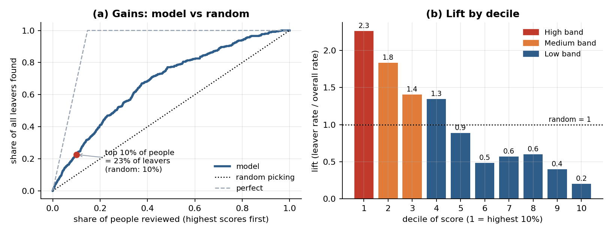

# Attrition risk score: a one-page guide for managers

**What the score is.** For each employee the model gives a risk score from 0% to 100%: its estimate of the chance of leaving within the next 12 months, based on pay, tenure, promotions, engagement, attendance and similar HR data. We sort everyone by score and split the list into three bands: **High** (the 10% with the highest scores), **Medium** (the next 20%) and **Low** (the other 70%). In our test that was 238 / 476 / 1665 of 2,379 people.

**How well it works.** We tested it only on people the model had not seen. Overall 14.7% of people left. In the High band 33% did (79 of 238), about 2.3 times the average; in Medium 24%; in Low 9%. The percentages are honest: the High band's average score was 35% and 33% of that group really left.

**What it cannot do.** It misses a lot. The High band holds only about 23% of everyone who left, and about 45% of leavers were in the Low band. About 67 in 100 people in the High band stayed. The score does not say why someone might leave, and it cannot know what you know, such as a recent conversation or a personal situation.

**What it is not.** It is not a verdict on any person, and not a reason to change someone's pay, promotion, workload or job. It must never be the basis for dismissal, discipline or a performance rating. **A score supports a human decision; it never makes one.**

**How to use it.**

1. Treat the High band as a prompt for a supportive check-in about workload, development and pay, led by someone who knows the person.
2. Look at each case yourself. Most people on the list will not leave.
3. Keep individual scores confidential and do not label anyone a "flight risk".
4. Use the Medium and Low bands only for team-level planning.
5. Expect to re-check the model regularly.

**Known limits.** It is built on only 349 leavers, so the numbers are uncertain: the High-band leaver rate could plausibly be anywhere from 27% to 39%. Most of the training data is simulated history; for the 379 employees in the current snapshot the ranking is weaker and only 6 High-band people left. Fairness across groups has not been tested yet, and two data questions are still open with the data team.

