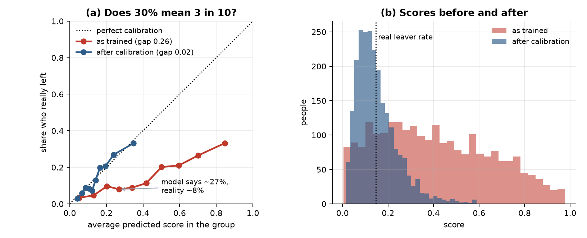
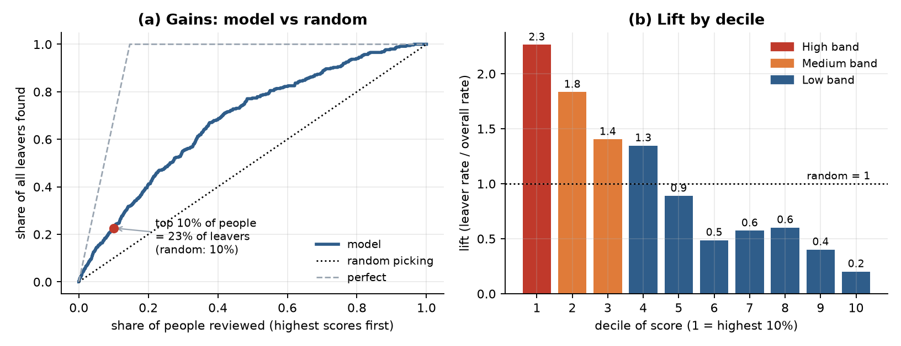

# Day 4 — Task 4: Metrics, calibration and risk bands (evidence report)

Notebook: [`notebooks/03_evaluation.ipynb`](../notebooks/03_evaluation.ipynb). Code: [`src/cortexhr/evaluation.py`](../src/cortexhr/evaluation.py). Tests: [`tests/test_evaluation.py`](../tests/test_evaluation.py). Manager note: [`Day4_Manager_Note.pdf`](Day4_Manager_Note.pdf) / [`Day4_Manager_Note.docx`](Day4_Manager_Note.docx) (source: [`day4_manager_note.md`](day4_manager_note.md)). Saved numbers and charts are in `tables/` and `figures/`.

**Status in the files supplied here:** the notebook, source, tests, metrics tables, calibration/lift charts, manager note, and source workbook are available. I reran the notebook end-to-end and all 29 focused Day 4 tests passed with Python 3.14.6, pandas 3.0.5, and scikit-learn 1.9.0. The full test suite and Docker were not rerun. The containing folder is not a Git repository, so the note and charts have not been committed.

**About the helper file:** the task says `cortexhr_helpers.py` (with `binary_report` and `risk_bands`) is provided. It was not available to me, so `src/cortexhr/evaluation.py` contains my own implementations under the same names. Check signatures against your team's file before swapping.

## 1. What was evaluated

The Task 3 logistic regression (`class_weight="balanced"`, Day 2 pipeline inside every fold), scored out-of-fold on the same stratified 5 folds: 2,379 people, 349 leavers (14.7%). The notebook asserts that its ROC-AUC equals the Task 3 value (0.7103), so it is the same model.

## 2. Metrics table

`binary_report(y, score)` on the out-of-fold scores. "Top-10%" = the 10% of people with the highest scores (238 people). @0.5 = yes/no at a 0.5 cut-off. Brier: lower is better; giving everyone the average rate scores 0.125.

| model | ROC-AUC | PR-AUC | top-10% precision | top-10% recall | top-10% lift | precision @0.5 | recall @0.5 | accuracy @0.5 | Brier |
|---|---|---|---|---|---|---|---|---|---|
| Dummy (always stays) | 0.500 | 0.147 | 0.146 | 0.100 | 0.997 | 0.000 | 0.000 | 0.853 | 0.147 |
| Logistic regression, balanced (Task 3) | 0.710 | 0.298 | 0.332 | 0.226 | 2.263 | 0.263 | 0.633 | 0.686 | 0.206 |
| Logistic regression, balanced + calibration | 0.711 | 0.296 | 0.332 | 0.226 | 2.263 |  |  |  | 0.116 |
| Decision tree, depth 4, balanced | 0.645 | 0.248 | 0.329 | 0.224 | 2.242 | 0.236 | 0.524 | 0.681 | 0.221 |

*Dummy and decision tree: top-10% figures are averages over 200 random tie-breaks (many people share a score). For the calibrated model almost nobody reaches 50% (15 people), so its @0.5 columns are left blank.*

Reading the numbers, in plain words:

* **ROC-AUC 0.71:** pick a leaver and a stayer at random; 71% of the time the leaver has the higher score.
* **PR-AUC 0.30:** see section 3. A useless list scores 0.147.
* **Top 10%:** 33% of the 238 people really left (precision), which is 2.3 times the overall rate; they are 23% of all leavers (recall).
* **At 0.5 the model behaves badly as an alarm:** it flags 35% of everyone and only 26% of flags are right (recall 63%).
* **Brier 0.206 is worse than the do-nothing 0.125**, the first sign that the as-trained scores are not probabilities.

## 3. PR-AUC in plain words (for a non-technical reader)

Imagine everyone in the company sorted from most to least at risk, and you walk down the list. Two questions matter at every step: of the people I have picked so far, how many really leave (*precision*), and of everyone who leaves, how many have I found so far (*recall*)? PR-AUC is roughly the average of that first answer as you walk down. If the leavers are bunched near the top, you stay accurate for a long time and the score is high; if they are scattered, you are only as accurate as the company-wide leaver rate (14.7%). That is why a list with no skill scores about 0.15, not 0.5. Our 0.30 is about 2 times better than that floor. The notebook has a 10-person worked example.

## 4. Calibration: does 30% really mean 3 in 10?



* **As trained, no.** The curve sits far below the diagonal: the average score is 41% while 14.7% really leave, and the average gap between predicted and actual (ECE) is 0.26. A group scored about 27% had only about 8% leavers. The cause is `class_weight="balanced"`, which counts each leaver about six times in training and pushes every score up. Good for ranking, wrong for reading as a percentage.
* **After calibration (Platt scaling, learned only on each fold's training data):** average score 15.1%, ECE 0.019, Brier 0.116 (better than the do-nothing 0.125). The ranking is almost unchanged (ROC-AUC 0.711 vs 0.710; Spearman correlation 0.997).
* **Decision:** the risk score used for bands and the note is the calibrated one. Using the as-trained score instead would move 68 of 2,379 people to a neighbouring band (swaps are paired, so band sizes stay fixed).
* **Caution:** each of the 10 groups holds about 238 people, so single points are noisy (the lowest group has 8 leavers). I chose to use the calibrated score after looking at this same out-of-fold data, so its good calibration is slightly optimistic.

## 5. Risk bands

`risk_bands(score)`: High = top 10%, Medium = next 20%, Low = the rest. Group sizes are exact (238 / 476 / 1,665).

| band | people | leavers | leaver rate | lift | share of all leavers |
|---|---|---|---|---|---|
| High (top 10%) | 238 | 79 | 33.2% | 2.26 | 22.6% |
| Medium (next 20%) | 476 | 113 | 23.7% | 1.62 | 32.4% |
| Low (rest) | 1665 | 157 | 9.4% | 0.64 | 45.0% |

* **Share of real leavers in the High band: 22.6%** (79 of 349); a random 10% would hold 10%. 95% bootstrap interval for this share: 19.1% to 26.3%; for the High-band leaver rate: 27.3% to 39.1%.
* **Bands are ordered correctly** (leaver rate 33% > 24% > 9%), and the average calibrated score per band (35% / 22% / 10%) is close to the real rate.
* **The list misses many leavers:** 157 of 349 (45%) are in the Low band, and about 67% of High-band people stayed.

## 6. Lift chart (think for yourself)



The top 10% (238 people) contains **79 real leavers**; picking 238 people at random would find about 35, so the lift is **2.26x**. Reviewing the top 20% finds 41% of leavers, the top 30% finds 55% and the top 40% finds 68%. Lift falls steadily down the list, as it should. Decile 4 is in the Low band but still has above-average lift (1.3): "Low" means lower than the others, not safe.

## 7. Stability

* **Fold by fold** (calibrated score): top-10% precision 0.346 ± 0.028, recall 0.238 ± 0.020, lift 2.36 ± 0.20 (mean ± sd over 5 folds). The pooled recall (22.6%) is a little lower than the fold average because pooling ranks scores from five slightly different models.
* **By row source** (bands cut across all rows together):

| rows | people | leavers | roc_auc | roc_auc_95% | in High band | leavers in High | High-band leaver rate |
|---|---|---|---|---|---|---|---|
| historical_extension | 2000 | 299 | 0.714 | 0.68 to 0.75 | 218 | 73 | 0.335 |
| master_employee_snapshot | 379 | 50 | 0.691 | 0.61 to 0.77 | 20 | 6 | 0.300 |

The master-snapshot rows have only 50 leavers and 6 in the High band, so that result is much less certain; it is also weaker. Say this whenever the numbers are quoted.

## 8. Checklist

| Item | Status | Evidence |
|---|---|---|
| Can explain PR-AUC to a non-technical person | Yes | section 3 |
| Bands counted and checked against real leavers | Yes | section 5 (238 / 476 / 1,665; 79/113/157 leavers) |
| Note says a score supports a human decision | Yes | `Day4_Manager_Note` ("A score supports a human decision; it never makes one") |
| Everything reproducible from one notebook | Yes | Notebook reran successfully with `data/raw/02_CortexHR_AI_ML_Dataset.xlsx` |
| Lift chart | Yes | section 6 |

## 9. Tests

Focused verification in this check: `python -m pytest tests/test_evaluation.py -v` — **29 passed in 43.95s**, including real-data tests. The report also contains an earlier full-suite result of **110 passed**; the full suite was not rerun here.

<details><summary>New tests (tests/test_evaluation.py)</summary>

```
tests/test_evaluation.py::TestTopK::test_exact_size_and_picks_the_highest PASSED [ 23%]
tests/test_evaluation.py::TestTopK::test_ties_follow_input_order_or_a_random_seed PASSED [ 24%]
tests/test_evaluation.py::TestTopK::test_bad_fraction PASSED             [ 25%]
tests/test_evaluation.py::TestBinaryReport::test_hand_checked_values PASSED [ 26%]
tests/test_evaluation.py::TestBinaryReport::test_precision_and_recall_at_top_are_different_things PASSED [ 27%]
tests/test_evaluation.py::TestBinaryReport::test_random_scores_give_chance_level_numbers PASSED [ 28%]
tests/test_evaluation.py::TestBinaryReport::test_perfect_scores PASSED   [ 29%]
tests/test_evaluation.py::TestBinaryReport::test_brier_is_nan_for_scores_that_are_not_probabilities PASSED [ 30%]
tests/test_evaluation.py::TestBinaryReport::test_bad_inputs_are_refused[y0-s0-both classes] PASSED [ 30%]
tests/test_evaluation.py::TestBinaryReport::test_bad_inputs_are_refused[y1-s1-same length] PASSED [ 31%]
tests/test_evaluation.py::TestBinaryReport::test_bad_inputs_are_refused[y2-s2-both classes] PASSED [ 32%]
tests/test_evaluation.py::TestBinaryReport::test_bad_inputs_are_refused[y3-s3-NaN] PASSED [ 33%]
tests/test_evaluation.py::TestRiskBands::test_sizes_are_exact_for_the_real_row_count PASSED [ 34%]
tests/test_evaluation.py::TestRiskBands::test_highest_scores_are_high_and_bands_are_ordered PASSED [ 35%]
tests/test_evaluation.py::TestRiskBands::test_input_order_and_index_do_not_matter_and_are_preserved PASSED [ 36%]
tests/test_evaluation.py::TestRiskBands::test_rank_based_so_any_increasing_transform_gives_the_same_bands PASSED [ 37%]
tests/test_evaluation.py::TestRiskBands::test_custom_fractions_and_bad_fractions PASSED [ 38%]
tests/test_evaluation.py::TestRiskBands::test_summary_counts_add_up_and_shares_of_leavers_sum_to_one PASSED [ 39%]
tests/test_evaluation.py::TestCalibration::test_matches_scikit_learn_quantile_curve PASSED [ 40%]
tests/test_evaluation.py::TestCalibration::test_well_calibrated_scores_have_small_gap_and_inflated_scores_a_big_one PASSED [ 40%]
tests/test_evaluation.py::TestCalibration::test_people_are_counted_once PASSED [ 41%]
tests/test_evaluation.py::TestCalibration::test_refuses_scores_that_are_not_probabilities PASSED [ 42%]
tests/test_evaluation.py::TestLiftAndGains::test_random_scores_have_lift_one_everywhere PASSED [ 43%]
tests/test_evaluation.py::TestLiftAndGains::test_perfect_ranking_puts_every_leaver_in_the_first_decile PASSED [ 44%]
tests/test_evaluation.py::TestLiftAndGains::test_gains_curve_endpoints_and_monotone PASSED [ 45%]
tests/test_evaluation.py::TestLiftAndGains::test_bootstrap_interval_contains_the_estimate_and_is_reproducible PASSED [ 46%]
tests/test_evaluation.py::TestRealDataset::test_as_trained_scores_are_inflated_and_calibration_fixes_it PASSED [ 47%]
tests/test_evaluation.py::TestRealDataset::test_bands_on_the_real_rows PASSED [ 48%]
tests/test_evaluation.py::TestRealDataset::test_top10_numbers_match_task3_ranking PASSED [ 49%]
```

</details>

Mutation check (manual, code restored afterwards): I broke the new code four ways. Three were caught at once (top-k picking the lowest scores, wrong Medium-band size, calibration table reporting predicted instead of observed). The fourth (recall computed as precision) **was not caught**: my hand-worked example happened to have precision equal to recall. I added a test where they differ, and the same break is now caught.

## 10. Limitations

1. My own `binary_report` / `risk_bands` implementations, not the team's file.
2. Only 349 leavers: the High-band leaver rate could plausibly be 27% to 39%.
3. Mixed row sources (see Day 2 and section 7); the master-snapshot result is weaker and rests on 6 High-band leavers.
4. Calibration was judged on the same out-of-fold rows used to decide to calibrate (slightly optimistic), and calibration may not transfer to new data.
5. This is cross-validation only. No final model has been fitted to score the 2026 employees, and the output format in `sample_attrition_risk` also needs reason codes (a later task).
6. Not done: fairness checks across groups, a cost-based choice of band sizes, time-based validation. The manager note says fairness is untested.
7. Open items O1 (negative tenure) and O2 (department rate) are still unanswered.
8. Not run: Docker or the full test suite. The fresh notebook run used pandas 3.0.5 and Python 3.14.6.

## 11. Commands

```bash
python scripts/run_notebook.py notebooks/03_evaluation.ipynb
pytest tests/test_evaluation.py -v
pytest -q
docker compose run --rm evaluation                              # after placing the workbook in data/raw/
```

Suggested commit message: `feat: add honest metrics, calibration, lift chart, risk bands and manager note for the attrition baseline`
