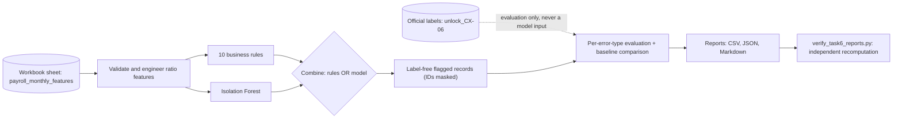

# Task 6 - Payroll Outlier Detector (CortexHR)

> **Official evaluation resource available.** The current workbook contains `unlock_CX-06`, and the pipeline uses it. The 100 labels in `payroll_anomaly_labels` match it exactly; that sheet is only a compatibility fallback when the required sheet is absent.

> **Fictional data.** Everything in the dataset (the company "Zenith Nova Technologies Pvt Ltd", its people, payslips, tax and PF figures) is **fictional**, generated for training. Any resemblance to real people or businesses is accidental.

**What it is and who it is for.** A command-line payroll checker built for Zenith Nova Technologies (part of Aura Workforce) for the CortexHR AI/ML project, Phase 2, Day 6. It reads monthly payslips, flags unusual ones using ratio features, ten explicit business rules and an Isolation Forest, and reports how well each approach finds the eight kinds of payroll error. It is for the payroll and HR-analytics team who need to know *which* checks catch *which* mistakes, and for internship reviewers checking the method. Task 5 is a separate upstream project; this work made no Task 5 changes.

## Live demo
Not applicable: Task 6 is a batch pipeline with a written report, not a hosted app, so there is no live URL. The evidence is in `task 6/reports/` (start with `task6_comparison_report.md`) and the architecture diagram below. A recorded walkthrough script is in `docs/WEEKLY_DEMO_SCRIPT.md`.

## Features
* Engineers 9 payroll ratio features (gross vs fixed pay, deductions vs gross, pay vs role norm, change vs last month, and more).
* Applies 10 transparent business rules (duplicate payment, negative/zero net pay, gross that does not add up, overtime cap, PF stopped, and others).
* Fits an Isolation Forest and combines rules OR model, keeping all three results separate.
* Scores all 8 error types separately (precision, recall, F1, 95% intervals) and compares with the published `anomaly_baselines` row.
* Produces masked, reviewable flagged-record files, a Markdown report and an independent reconciliation script.

### What the workbook contains (inspected, not assumed)
| Resource | Sheet | Shape |
|---|---|---|
| Features | `payroll_monthly_features` | 7,355 rows x 23 columns, 528 employees, 18 monthly runs |
| Official labels | `unlock_CX-06` | 100 rows, 8 mutually exclusive error types |
| Compatibility labels | `payroll_anomaly_labels` | 100 rows; verified identical to the official sheet |
| Baseline | `anomaly_baselines` (payroll row) | IF on ratios, 2.5% contamination: flagged 184, precision 0.217, recall 0.40 |

All 100 labels join to the features on `payroll_item_id` (0 unmatched, 0 duplicate keys; asserted on every run).

### Method in plain English
* **Ratios** (`payroll_features.py`): gross vs fixed gross, deductions vs gross, net vs gross, gross vs what it *should* be (fixed x payable days + overtime + variable),
  pay vs the role median from the **previous calendar month**, change vs the employee's **previous calendar month**, overtime hours/share, PF vs last month. Division by zero gives NaN, never 0 or inf.
* **Rules** (`payroll_rules.py`, ten, configurable via `RuleConfig`): duplicate payment, negative net, zero net (only if payable days > 0), gross reconciliation, overtime cap 50 h,
  PF stopped, fixed-gross drop, fixed-gross jump, pay > 2x the prior-month role median, invalid amounts. Definitions with false-positive notes: `reports/task6_rule_definitions.csv`.
* **Isolation Forest** (`payroll_model.py`): 9 ratio features, median imputation, `random_state=42`, `contamination=0.025`, 200 trees. 2.5% was fixed before seeing labels to match
  the baseline's alert budget (a limitation: it is not an estimate of the real error rate). A hard guard rejects identifier and label columns as features; the `PI-D` id prefix reveals double payments, so ids are never features.
* **Combined** = `rules_only_flag OR if_flag`. Rules-only and model-only flags are computed independently (tested) and stay in every output.
* **Evaluation** (`payroll_evaluation.py`, the only label reader): one-vs-clean per error type, same 7,355-payslip population for every row. Full metrics include TP, FP, FN, and TN (TN counts unlabelled payslips not flagged); 95% Wilson intervals are reported. The official sheet is loaded after predictions; a missing official sheet triggers a loud provisional-result warning before using the compatibility sheet.

## Tech stack
Python 3.14.6 was used for Windows validation; pandas, NumPy, scikit-learn (IsolationForest), openpyxl (reading the workbook), pytest. No web framework, database or Docker is used by Task 6.

## Run it locally
Run everything from the repository root (Windows PowerShell or any shell). Windows verification was run with Python 3.14.6.

1. **Install the dependencies**
   ```bash
   python -m pip install -r "task 6/requirements.txt"     # pandas, numpy, scikit-learn, openpyxl, pytest
   ```
2. **Make sure the dataset can be found.** The script looks for `02_CortexHR_AI_ML_Dataset.xlsx` in this order: `--workbook <path>`, the environment variable `CORTEXHR_WORKBOOK`, `task 6/data/raw/`, then the documented shared-data locations if present. The workbook and `unlock_CX-06.csv` are local evaluation data and are git-ignored.
3. **Task 5 regression tests:** run `python -m pytest "task 5/tests"` from the repository root to check the upstream integration.
4. **Run the Task 6 tests** (mostly synthetic fixtures; real-workbook tests run when a workbook is available)
   ```bash
   python -m pytest "task 6/tests"
   ```
5. **Run the detector.** It uses `unlock_CX-06` when available. If only the compatibility labels are present, it prints a warning and marks evaluation provisional.
   ```bash
   python "task 6/scripts/run_task6.py"
   ```
6. **Check the saved reports** with an independent recomputation, then read `task 6/reports/task6_comparison_report.md`.
   ```bash
   python "task 6/scripts/verify_task6_reports.py"
   ```
7. *(Optional)* **Re-check the first experiment** (identical to the frozen files in `reports/original_experiment/`):
   ```bash
   python "task 6/scripts/run_task6.py" --original-experiment --reports-dir "task 6/reports/original_experiment_rerun"
   ```

Windows validation on Python 3.14.6: 96 Task 6 tests passed, the end-to-end run exited 0 using `unlock_CX-06`, and independent report verification passed.

## Architecture

The same diagram, with module names, is in `docs/ARCHITECTURE.md`. Labels are read only by `payroll_evaluation.py`, after all predictions exist.

## How I verified it works
### Results by error type (official labels)
| Error type | Cases | Model P | Model R | Rules P | Rules R | Combined P | Combined R |
|---|--:|--:|--:|--:|--:|--:|--:|
| DOUBLE_PAYMENT | 15 | 0.000 | 0.000 | 0.349 | 1.000 | 0.088 | 1.000 |
| MISSED_DEDUCTION | 15 | 0.023 | 0.200 | 0.333 | 0.933 | 0.082 | 0.933 |
| NEGATIVE_NET | 8 | 0.059 | 1.000 | 0.222 | 1.000 | 0.049 | 1.000 |
| OVERTIME_SPIKE | 15 | 0.092 | 0.867 | 0.222 | 0.533 | 0.077 | 0.867 |
| ROLE_MISMATCH | 15 | 0.105 | 1.000 | 0.349 | 1.000 | 0.088 | 1.000 |
| STALE_SALARY | 12 | 0.008 | 0.083 | 0.300 | 1.000 | 0.071 | 1.000 |
| WRONG_DECIMAL | 15 | 0.105 | 1.000 | 0.349 | 1.000 | 0.088 | 1.000 |
| ZERO_PAY | 5 | 0.008 | 0.200 | 0.152 | 1.000 | 0.031 | 1.000 |
| **ALL ERRORS** | 100 | 0.304 | 0.560 | 0.767 | 0.920 | 0.383 | 0.970 |

Per-type precision shares one false-alarm count (the detectors do not predict the error type), so it is low for small types. Rule-specific precision is in `task6_rule_hits.csv`.
Each recall is uncertain: for example ZERO_PAY 5/5 has a 95% interval of 0.57-1.00 (`task6_metrics_per_type.csv`, report section 7).

| Detector (pooled, same population and definitions as `anomaly_baselines`) | Flagged | TP | FP | Precision | Recall | F1 |
|---|--:|--:|--:|--:|--:|--:|
| Published baseline | 184 | 40 | 144 | 0.217 | 0.400 | 0.281 |
| Rules only | 120 | 92 | 28 | 0.767 | 0.920 | 0.836 |
| Isolation Forest only | 184 | 56 | 128 | 0.304 | 0.560 | 0.394 |
| Combined (rules OR model) | 253 | 97 | 156 | 0.383 | 0.970 | 0.550 |

**Rules + model vs model alone:** recall 0.970 vs 0.560 (+41 true errors); precision 0.383 vs 0.304.
**The combined detector is not "better" in every sense:** against rules alone it adds 5 true errors and 133 model-only alerts (128 of them false alarms), so reviewer workload rises from 120 to 253 alerts
and precision falls from 0.767 to 0.383. All three results are kept. An *experimental* two-tier view (rule alerts = high-confidence; model-only alerts = review queue) is in `task6_experimental_tiered_alerts.csv`:
tier 2 has 133 alerts and finds 5 true errors. It does not replace any detector.

**Baseline reproducibility.** The replica of the baseline recipe gets TP 33-38 across seeds 0-9; the published TP of 40 is outside that range, so the published row is **not reproducible** from what the sheet documents. Use the pooled published row for headline comparison; per-type baseline numbers are approximate.

**What rules catch that the model misses:** all 15 double payments, 11 of 15 missed-PF, 11 of 12 stale-salary, 4 of 5 zero-pay. The model alone finds 5 payslips rules miss (all overtime spikes below the 50 h cap).

**Hardest error type.** For the Isolation Forest alone: DOUBLE_PAYMENT (0/15) - an exact copy of an ordinary payslip has ordinary ratios, but a person sees the same payslip twice.
For the combined detector: OVERTIME_SPIKE (13/15). The two misses (6 h and 12 h) lie within the overtime range of ordinary payslips (median 8.5 h, max 29 h), so a person would **not** find them easy without the approved timesheet, which is not in the dataset.
The rarest type (ZERO_PAY, 5 cases) is not the hardest. Samples are small.

### Changes made after the original experiment (kept separate on purpose)
The first experiment's outputs are frozen in `reports/original_experiment/` and can be re-created with `--original-experiment` (re-checked: identical).

**1. Corrections for methodological reasons** (found by a row-shuffle check, not chosen from labels; their effect on the metrics was measured afterwards):
the duplicate rule flagged "the later row in the file", the Isolation Forest was fitted in file order, and the "previous month" lookup used the previous *row*. Now the duplicate rule flags the whole same-employee/same-month/same-amount group by default,
rows are put in a canonical order before the forest is fitted, and history uses the previous calendar month. Shuffled or reversed input gives identical results (tested on synthetic and real data).

| Detector | Original experiment: flagged / P / R | Corrected default: flagged / P / R |
|---|---|---|
| Rules only | 105 / 0.876 / 0.920 | 120 / 0.767 / 0.920 |
| Isolation Forest only | 184 / 0.304 / 0.560 | 184 / 0.304 / 0.560 |
| Combined | 238 / 0.408 / 0.970 | 253 / 0.383 / 0.970 |

Rules precision fell because the legitimate original of each duplicate pair is now flagged too; the labels mark only the injected copy, so those 15 originals count as false alarms although a reviewer would want to see both.
The dataset has **no payment or bank reference**, so the duplicate rule can only say *possible duplicate*; it cannot prove which copy is the extra payment.

**2. `rule_salary_drop` review - post-evaluation analysis, rule left unchanged.**
Condition: fixed gross < 0.99 x the same employee's fixed gross in the previous calendar month (no flag if that month is missing; independent of row order).
It is a legitimate control (cross-period consistency) but has **0 true positives and 13 false alarms** here; all 13 are the month after a ROLE_MISMATCH payslip (salary returning to normal).
These facts were seen *after* looking at labels. The hypothesis "suppress the alert after a flagged spike if pay returns to the pre-spike level" is implemented as an off-by-default option and tested,
but **not adopted**: if the earlier jump was a genuine large raise and payroll then reverts to the old salary, that is exactly a stale-salary error and the suppression would hide it (a test demonstrates this),
and the dataset has no information on whether spikes were reviewed. Exploratory result: 3 of 13 flags remain; rules precision 0.767 -> 0.836 (`task6_salary_drop_review.csv`). This is **not** an unbiased evaluation.

### Test results
`python -m pytest "task 6\tests"`: 96 passed on Windows. The Task 5 test directory is absent from this workspace, so its regression suite could not be run.
`python "task 6\scripts\run_task6.py"`: exit 0 using the official `unlock_CX-06` sheet. `python "task 6\scripts\verify_task6_reports.py"`: OK.
Row-shuffle and row-reversal tests check input-order independence, and the real-workbook regression test preserves the frozen original experiment's overall counts.

## Limitations and what I would do next
1. Labels are synthetic injected errors with crisp signatures; the rules were designed knowing the eight error-type names. Thresholds were not tuned on labels, but rules-only numbers are optimistic versus real payroll.
2. Only 5-15 labelled cases per type: one missed payslip moves recall by 7-20 points.
3. Contamination 2.5% copies the baseline; the actual labelled rate is 1.36%.
4. The model is transductive: it is fitted and scored on the same 18-month batch. Validate on a later, unseen period before production use.
6. Task 5 is a separate upstream project; its regression suite can be run from the repository root.

**Next steps:** review the Git staging area in the complete repository; record the demo video; add a payment/bank reference for the duplicate rule; add a per-employee overtime history feature; have a payroll owner review thresholds and decide on `rule_salary_drop`; validate on a later, unseen period.

## Outputs (`task 6/reports/`)
| File | Content |
|---|---|
| `task6_comparison_report.md` | Full report |
| `task6_metrics_per_type.csv`, `task6_results_table.csv` | All metrics (TP/FP/FN/P/R/F1/support/95% intervals) and the wide table |
| `task6_baseline_comparison_*.csv`, `task6_baseline_replica_seeds.csv` | Baseline comparison and replica seed check |
| `task6_rules_vs_model_overlap.csv`, `task6_rule_hits.csv` | Rules-only / model-only / both / missed; per-rule hits and false alarms |
| `task6_original_vs_current_vs_exploratory.csv`, `task6_salary_drop_review.csv`, `task6_experimental_tiered_alerts.csv` | Before/after tables (post-evaluation parts labelled) |
| `task6_flagged_records.csv` | Label-free masked review file |
| `task6_data_dictionary.csv`, `task6_feature_definitions.csv`, `task6_rule_definitions.csv` | Documentation |
| `task6_sensitivity.csv`, `task6_examples_masked.csv`, `task6_missed_errors.csv`, `task6_run_summary.json` | Post-hoc checks, examples, misses, configs/join/leakage checks |
| `original_experiment/` | Frozen first-experiment outputs |
| `private/task6_record_key.csv` | masked-ref to real-id map (**git-ignored**) |

Row-level label-linked evidence (`task6_flagged_records_with_labels.csv`, `task6_examples_masked.csv`, `task6_missed_errors.csv`) is generated locally for report reconciliation and review, and is git-ignored; submit aggregate metrics instead. The source workbook, official answer-key CSV and raw-ID mapping also stay private.

IDs are masked with a keyed hash. By default the key is random for each process, so references are stable across that run's output files but change on a later run. Set a strong `CORTEXHR_ID_SALT` environment secret if cross-run stable references are required; never commit the secret.

## Project documents
`docs/DAILY_LOG.md`, `docs/PULL_REQUEST_CX-06.md`, `docs/FINAL_SUBMISSION_CHECKLIST.md`, `docs/STUCK_HELP_unlock_CX-06.md`, `docs/WEEKLY_DEMO_SCRIPT.md`, `docs/RELEASE_NOTES.md`, `docs/ARCHITECTURE.md`.
