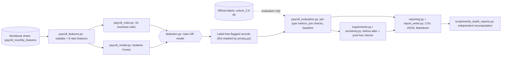

# Architecture - Task 6 Payroll Outlier Detector

| Module (`task 6/src/cortexhr_task6/`) | Job |
|---|---|
| `data_loading.py` | Finds and reads the workbook sheets (features, baseline). Never reads labels. |
| `payroll_features.py` | Validates rows, makes ratio features, and uses prior-calendar-month employee history and role references. |
| `payroll_rules.py` | Ten transparent rules with configurable thresholds. |
| `payroll_model.py` | Isolation Forest with a guard that rejects identifier or label columns. |
| `detection.py` | Runs features, rules and model, then combines them (rules OR model). |
| `payroll_evaluation.py` | The **only** module that reads labels; join validation, per-type metrics, intervals. |
| `experiments.py`, `sensitivity.py` | Original vs corrected vs exploratory comparisons; post-hoc checks (reporting only). |
| `reporting.py`, `report_writer.py` | Data dictionary, masked examples, the Markdown report (all numbers computed). |
| `privacy.py` | Keyed-hash masking of employee and payslip IDs. |

**Key rule:** predictions are produced and saved first; labels are loaded afterwards and never reach the model or the rules.
